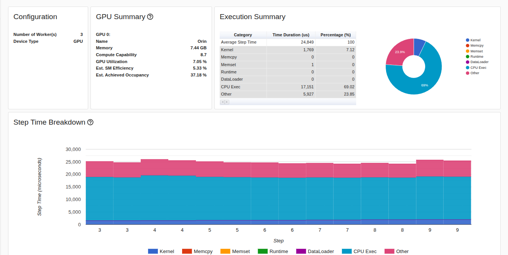
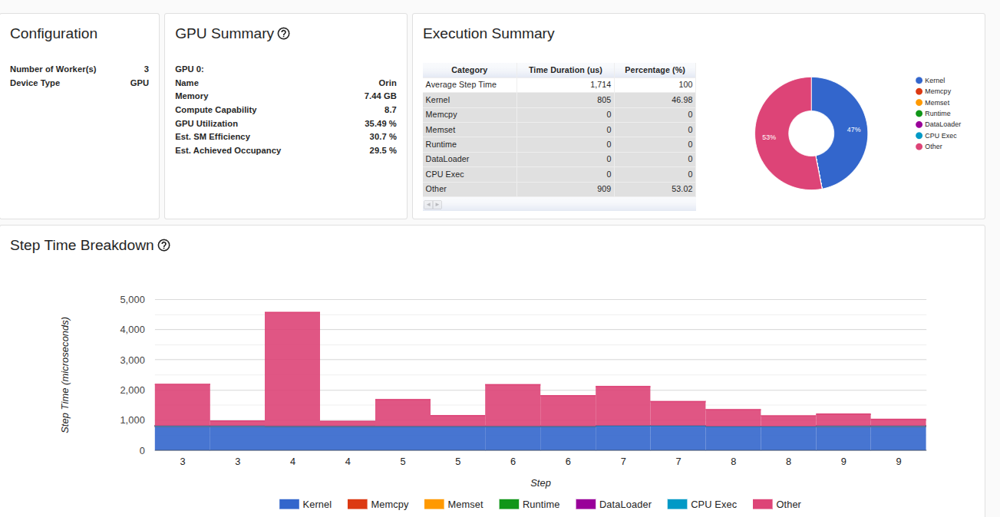
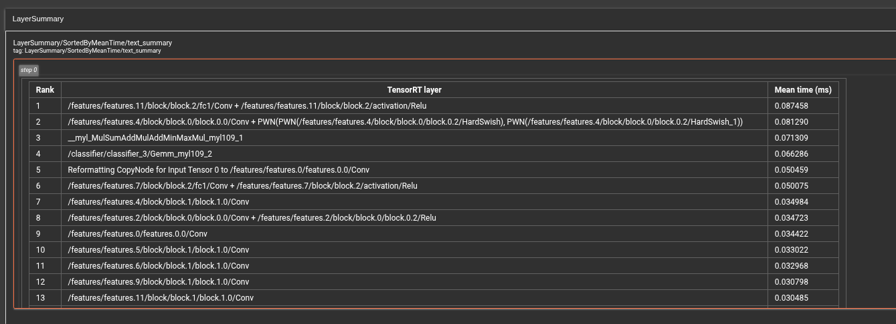

# MobileNetV3-Small Baseline 性能剖析报告

## 目的与范围

本报告汇总 baseline 阶段 PyTorch / TensorRT 对照剖析、TensorRT 逐层耗时和 Nsight Systems 时间线，用来确定 V1 优化方向。数据来自 Jetson Orin 上的实际运行。带 profiler 的数据用于找线索；未挂 profiler 的 `trtexec` 数据用于观察 engine 延迟。它们都不是完整应用端到端延迟。

## 测试条件

| 项目 | 设置 |
| --- | --- |
| 设备 | TensorBoard 显示为 Jetson Orin；具体 SKU 未记录 |
| TensorRT | 10.3.0 |
| 模型 | MobileNetV3-Small |
| Engine | `engine/mobilenet_v3_small_fp16.engine` |
| 图片输入 | `dog.jpg`，使用 `MobileNet_V3_Small_Weights.IMAGENET1K_V1.transforms()` 预处理 |
| 网络输入 | `[1, 3, 224, 224]`，FP16 |
| 对照测试 | PyTorch 与 TensorRT 使用同一张预处理后的图片；模型和 engine 均在 GPU 上运行 |
| TensorRT layer profile | `02-bench.py` 使用 `dog.jpg`；循环内只执行 engine，输入准备和图片预处理在循环外 |
| `trtexec` 基准 | 同一个 FP16 engine，`--noDataTransfers`，warm-up 500 ms，测量 3 秒；使用 TensorRT 默认生成的输入，不是 `dog.jpg` |

## 运行结果

### PyTorch 与 TensorRT 对照 trace

数据从本次 `01-compare.py` 写出的 trace 读取。Step 包含 CPU 提交、同步和 profiler 开销，不能当作生产推理延迟，也不应直接据此计算加速比。

| Worker | Step 平均值 (ms) | Step 中位数 (ms) | trace 内 GPU kernel 总时长 / Step (ms) |
| --- | ---: | ---: | ---: |
| PyTorch Model | 25.545 | 25.630 | 1.729 |
| TensorRT Engine | 2.023 | 1.609 | 0.789 |

PyTorch 模型权重先加载到 CPU，随后执行 `MODEL.cuda().half()`；图片也通过 `.cuda().half()` 放到 GPU。因此 PyTorch 这组数据是 GPU 推理。Step 时间明显大于 GPU kernel 总时长，其中包含 Python / PyTorch 调度、每步同步及 profiler 采集成本。

### TensorRT 无 profiler 延迟基准

以下结果来自单次 3 秒 `trtexec` 测量，分别运行 eager 和 CUDA Graph。`--noDataTransfers` 排除了 H2D / D2H 传输，因此是 engine 执行结果，不含图片预处理、应用输入拷贝和后处理。

| Engine 执行方式 | Throughput (qps) | 延迟均值 (ms) | 中位数 (ms) | P90 (ms) | P95 (ms) | P99 (ms) | Enqueue 中位数 (ms) | CV |
| --- | ---: | ---: | ---: | ---: | ---: | ---: | ---: | ---: |
| Eager | 930.29 | 1.071 | 0.951 | 0.957 | 2.122 | 3.329 | 0.681 | 41.8% |
| CUDA Graph | 1289.59 | 0.772 | 0.665 | 0.667 | 1.847 | 3.280 | 0.011 | 57.9% |

本次 CUDA Graph 的中位延迟比 eager 低约 30%，吞吐约高 39%，enqueue 中位数从约 0.681 ms 降到约 0.011 ms。这表明减少 CPU 逐 kernel 提交开销是当前值得优先验证的方向。两次测量的变异系数都很高，P95 / P99 也有明显长尾；这是单次短测，不能视为稳定结论。应在相同温度和运行条件下重复测量，并以多次运行的中位数和分位数判断收益。

Nsight Systems 采集期间的时间线也显示 eager 路径会频繁提交 CUDA kernel，而 Graph 路径通过 graph launch 回放。Nsight 自身会增加开销，所以 Nsight 中的单次延迟不作为上表基准；`.nsys-rep` / `.sqlite` 用于检查 CPU 提交、同步和 GPU kernel 的先后关系。

### TensorRT 逐层 profile

`02-bench.py` 对真实 `dog.jpg` 输入运行了 20 次 TensorRT `IProfiler` 逐层采集，共得到 113 个 layer 项。下面按每层 20 个样本的**中位数**排序；这里用中位数是因为少量长尾会显著拉高均值。

| 排名 | Engine layer | 每层中位耗时 (ms) |
| ---: | --- | ---: |
| 1 | `__myl_MulSumAddMulAddMinMaxMul_myl109_1` | 0.0592 |
| 2 | `/classifier/classifier_3/Gemm_myl109_2` | 0.0493 |
| 3 | `Reformatting CopyNode for Input Tensor 0 to .../features.0.0/Conv` | 0.0472 |
| 4 | `/features/features.0/features.0.0/Conv` | 0.0331 |
| 5 | `/features/features.2/block/block.0/.../Conv + .../Relu` | 0.0330 |
| 6 | `/features/features.6/block/block.1/block.1.0/Conv` | 0.0290 |
| 7 | `/features/features.4/block/block.1/block.1.0/Conv` | 0.0290 |
| 8 | `/features/features.5/block/block.1/block.1.0/Conv` | 0.0285 |

第一名 layer 的样本中位数是 0.0592 ms，但均值被少数异常长样本抬到了 0.4719 ms，最大值为 4.1183 ms。TensorRT layer profile 适合定位候选项；这些逐层值不应相加后当作端到端延迟，也不能单独证明某个算子就是整个模型的瓶颈。

当前耗时分布在多个小型卷积 / 融合层中，没有证据表明只优化一个卷积就能显著降低总延迟。`Reformatting CopyNode` 值得检查，但先确认 engine 输入格式和实际绑定格式；不能仅凭名字断定一定能删掉该转换。`__myl_...` 是 TensorRT 生成的内部 layer / kernel 名称，需结合 Nsight 时间线或 Nsight Compute 继续确认其实际执行特征。

## 数据文件

- PyTorch / TensorRT 对照 trace：`profiling/PyTorch_Model_Compare.*.pt.trace.json`、`profiling/TensorRT_Engine_Compare.*.pt.trace.json`
- TensorRT 实际图片逐层 trace：`profiling/TensorRT_Engine_Bench.*.pt.trace.json`
- TensorRT 逐层 TensorBoard events：`profiling/TensorRT_Bench/events.out.tfevents.*`
- Nsight Systems 报告：`profiling/nsys/trt-eager.nsys-rep`、`profiling/nsys/trt-cudagraph.nsys-rep` 及对应 `.sqlite`
- 本次未挂 Nsight 的 `trtexec` 完整日志：`profiling/nsys/trtexec-eager.log`、`profiling/nsys/trtexec-cudagraph.log`
- 执行脚本：`01-compare.py`、`02-bench.py`、`03-nsight.sh`

从 baseline 目录查看 TensorBoard：

```bash
tensorboard --logdir=profiling
```

在 TensorBoard 的 `Runs` / `Workers` 下选择 `PyTorch_Model`、`TensorRT_Engine` 或 `TensorRT_Engine_Bench` 查看 profiler trace；`TensorRT_Bench` 目录包含逐层标量和排序表。不要只看默认选中的 worker。屏幕截图是此前提供的 TensorBoard 截图，保留作界面和数据展示参考；截图的采集时间与本次 trace 不完全一致，精确数值以本报告的本次运行结果及 `profiling/` 文件为准。

## V1 优化建议

1. **先验证 CUDA Graph。** 固定 batch 1、输入 shape、context、输入输出地址和 stream，在实际 C++ 推理路径中做 graph capture / replay。该模型输入尺寸固定，本次 `trtexec` 结果显示 enqueue 开销明显下降。用多次重复的未挂 profiler 测量确认延迟和吞吐收益，再保留或撤销该改动。
2. **检查输入 Reformat。** 用 TensorRT Engine Inspector / `trtexec --dumpLayerInfo` 查看输入和首层的 dtype、tensor format、实际 I/O 格式，确认应用输入是否触发了额外格式转换。优化前后要在同一输入 shape、精度和准确性验证下重新测量。
3. **暂不手写 CUDA kernel 替换单个 layer。** 当前逐层数据有长尾，`__myl_...` 名称不足以判断其内部瓶颈；先用 Nsight Compute 查看候选 kernel 的带宽、占用率和指令效率。只有确认它稳定占据主要 GPU 时间后，再考虑自定义 kernel 或插件。
4. **先把基准稳定下来。** 当前 eager 和 CUDA Graph 的 P95 / P99 与中位数差距很大，且 CV 分别为 41.8% / 57.9%。保持设备温度、后台负载和输入 shape 一致，延长测量时间并重复多轮；报告每轮的 median、P90、P95、P99 和温度 / 频率。本次命令未显式锁定 GPU 频率。
5. **明确目标再尝试 batch 或 INT8。** batch 增大可能改善吞吐但增加排队延迟和内存；INT8 需要校准并重新做任务精度验证。当前 engine 已是 FP16，先完成 CUDA Graph 和输入格式验证，再决定是否需要这两类改动。

V1 至少应包含：CUDA Graph 版本、与 baseline 相同条件的重复延迟数据，以及真实验证集上的分类精度 / 任务结果。单张 `dog.jpg` 适用于 profiling，不足以代替任务精度验证。

## TensorBoard 截图

### PyTorch Model Overview



### TensorRT Engine Overview



### TensorRT 逐层耗时排序截图


